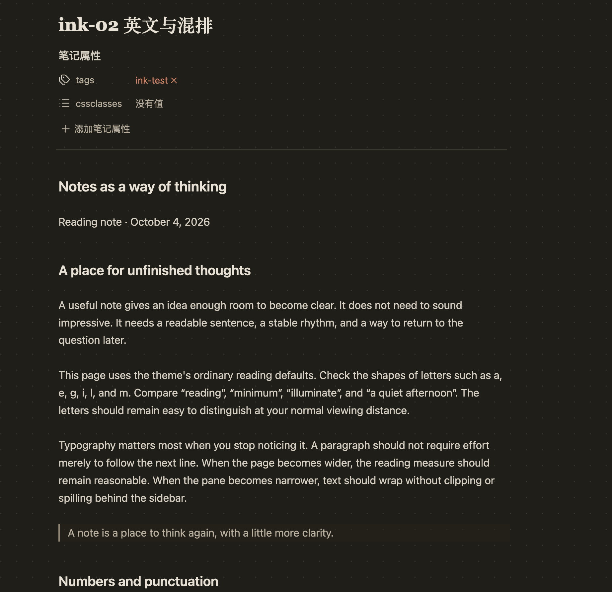
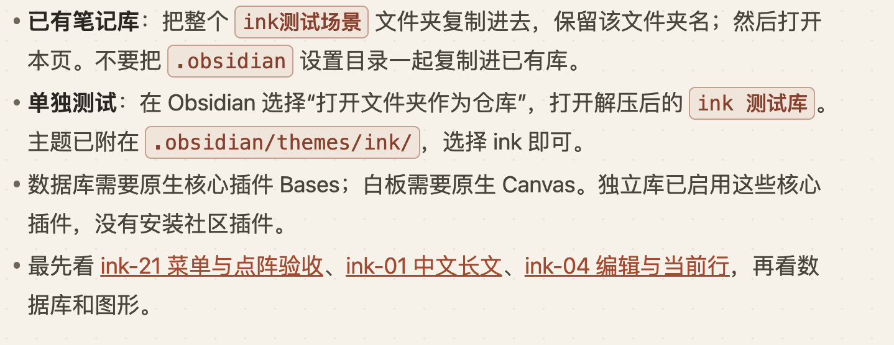

# ink

A warm paper-inspired Obsidian theme by [ThreeAndTwo](https://github.com/ThreeAndTwo), available under the [MIT License](LICENSE).

[中文说明](README.zh-CN.md) · [Current source 0.0.3](https://github.com/ThreeAndTwo/obsidian-ink-theme/tree/main)

## Install

The current source version is **0.0.3**. Install it with [manifest.json](https://raw.githubusercontent.com/ThreeAndTwo/obsidian-ink-theme/main/manifest.json) and [theme.css](https://raw.githubusercontent.com/ThreeAndTwo/obsidian-ink-theme/main/theme.css) from main, keeping the repository license notices.

Earlier packaged release: [ink-0.0.2.zip](https://github.com/ThreeAndTwo/obsidian-ink-theme/releases/download/0.0.2/ink-0.0.2.zip). That archive retains the earlier appearance.

Requires Obsidian **1.8.0 or later**.

1. Create an `ink` folder containing the current `manifest.json` and `theme.css`; keep the license notices with it.
2. Put that folder in your vault's `.obsidian/themes/` directory. The final paths must be `.obsidian/themes/ink/manifest.json` and `.obsidian/themes/ink/theme.css`.
3. In Obsidian, open **Settings → Appearance → Themes**, select **ink**, and choose light or dark mode.
4. When updating an existing installation, replace those two files and reselect the theme or restart Obsidian.

No build command, Node.js or community plugin is needed to install the theme. You can also download `manifest.json` and `theme.css` individually from the release. GitHub's automatic “Source code” downloads are repository snapshots; use the named theme ZIP for installation.

`.obsidian` is hidden. In macOS Finder, press **Command + Shift + .** to show hidden files; on Windows, enable hidden items in File Explorer. Install into the vault folder, not the application's installation folder. If ink does not appear, check for an extra folder level such as `ink/ink/`.

ink has not been listed in Obsidian's community theme browser. Manual installation from this release is available. In-app search and installation require [community-directory submission and approval](https://docs.obsidian.md/themes/app-themes/submit-theme).

Obsidian's community directory reads this repository's manifest and installs `manifest.json` and `theme.css` from the GitHub release with the matching tag. The directory and the manual download use the same version and files.

## Palettes and reading

Classic is the default: a light bamboo-inspired paper palette and warm dark ink, with coordinated deep teal, clay and graphite note colors. Heading sizes, weights and spacing distinguish H1–H6 independently of color. Quotes, emphasis, links, highlights and inline code use the same palette relationships.

With the optional Style Settings plugin, use **INK → Appearance → Color palette**. Classic, Neutral, Original, Bamboo, Yanzhi and Tianqing are in one CSS file. Existing choices retain their IDs; select Classic once if you previously chose another option. Without Style Settings, Classic is automatic. Obsidian's Base color chooses light, dark or Follow system.

The soft shell and folder disclosure animation preserve native navigation and reduced-motion behavior. [Native margin notes](docs/MARGIN-NOTES.zh-CN.md) and [comment presentation](docs/COMMENT-UI.md) are included; [INK Annotator](https://github.com/ThreeAndTwo/ink-annotator) provides anchored comment interaction and saved edits.

Prose arrow ligatures and [language-learning examples](docs/language-learning.md) remain available. The ligatures only affect display; stored text stays unchanged.

## Note content

These are original screenshots supplied by ThreeAndTwo during development. Their exact installed theme versions were not confirmed; they are not verified 0.0.2 acceptance screenshots. No generated mockups are used.

### Dark

### Light — earlier development capture

The light image shows an earlier terracotta inline-code style. The release uses neutral inline code. Fresh paired light/dark captures for 0.0.2 are still pending.

## Features

- Warm light and dark palettes with a subtle optional dot grid.
- Centered reading, readable system body fonts and serif page titles; no external font downloads.
- Distinct links, bold text, highlights and neutral inline code.
- A full-width dotted baseline for the current logical editing line.
- Markdown, tasks, tables, callouts, diagrams, Canvas and Bases styles.
- Monochrome Tasks metadata and query actions, readable dates and distinct priority levels; task data stays unchanged.
- Optional [Style Settings](https://github.com/mgmeyers/obsidian-style-settings) customization; the theme works without the plugin.

The readable CSS source is `theme.css`. This repository contains the theme distribution, documentation and screenshots; development fixtures and internal verification tools are not needed for installation.

## Boundaries and feedback

OS-native menus, user fonts/colors and third-party plugins can affect the result. Task dates and emoji remain in the note. The 17 supported task symbols also change when used inside a task description; ordinary paragraphs and unrelated emoji keep their fonts. Raw editing views lack the plugin's metadata spans, so component badges and priority colors apply to Reading/query results. Diagram and Bases features depend on the installed Obsidian version. The owner accepted the local desktop appearance; a complete device and plugin matrix is not claimed.

Report problems in [Issues](https://github.com/ThreeAndTwo/obsidian-ink-theme/issues) with your Obsidian/ink versions, operating system, view, light/dark mode and a real screenshot. Include a small example note or diagram, steps to reproduce, the expected and actual results, and relevant plugins, CSS snippets or font overrides.

## License

[MIT](LICENSE) © 2026 ThreeAndTwo. The distributable `theme.css` also contains the license notice.

Lucide icon and Bamboo China source-palette notices are included in `licenses/`. Workspace, reading and motion changes are implemented in this theme; Codex and Cupertino were design references only.
